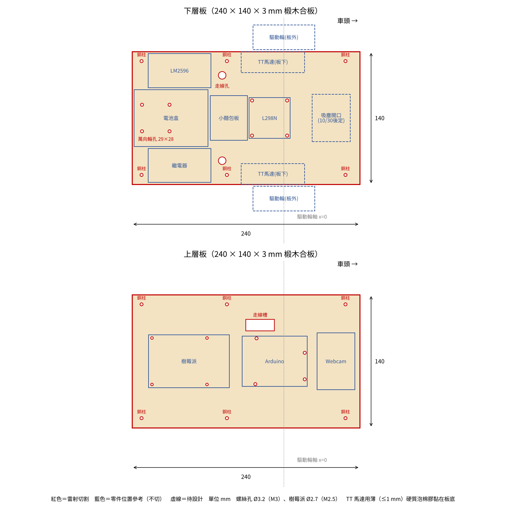
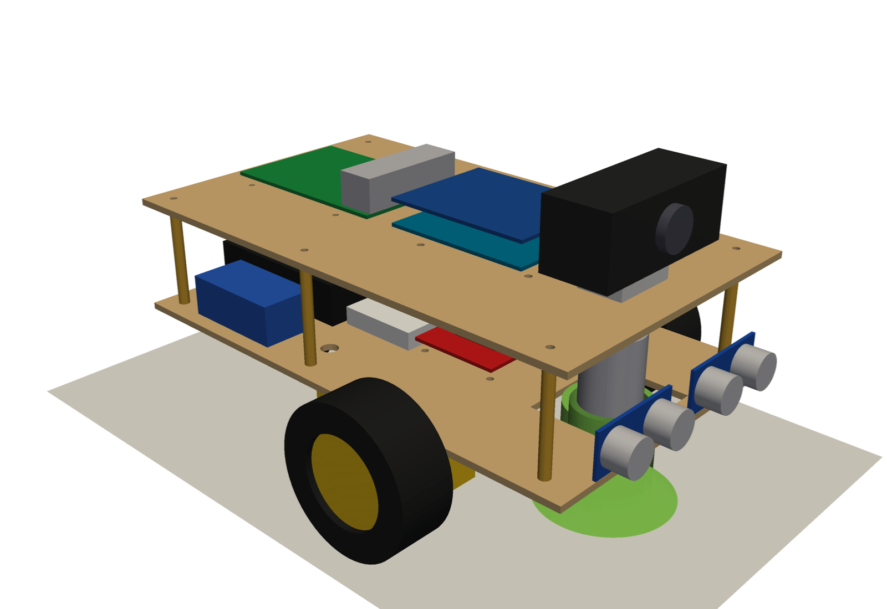
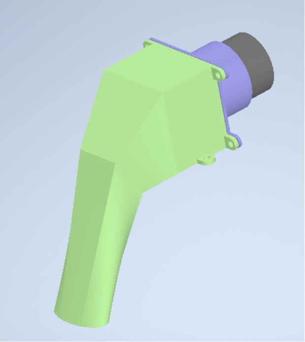
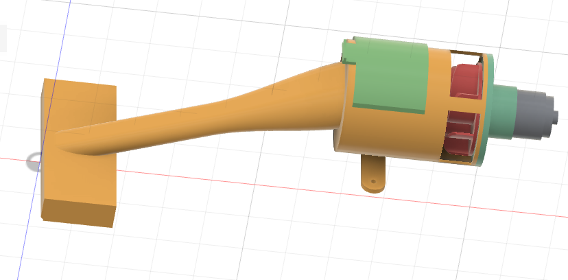

# G09 智慧吸塵車（Smart Vacuum Car）

國立臺灣大學 生物機電工程學系　機電整合（四）期末專題　第 9 組

一台可以**透過網頁遠端遙控**的吸塵小車：車上的 Webcam 即時串流畫面到瀏覽器，使用者用鍵盤操控行進方向與吸塵馬達。

<!-- 組員名單：經全體同意後再填入 -->

---

## 目錄

- [我的貢獻](#我的貢獻)
- [系統架構](#系統架構)
- [資料夾結構](#資料夾結構)
- [硬體](#硬體)
- [機構設計](#機構設計)
- [軟體安裝與執行](#軟體安裝與執行)
- [操作方式](#操作方式)
- [通訊協定](#通訊協定)
- [安全設計](#安全設計)
- [吸塵模組設計與迭代](#吸塵模組設計與迭代)
- [遇到的問題與解法](#遇到的問題與解法)
- [常見問題](#常見問題)

---

## 我的貢獻

本專案為五人小組合作。我負責的部分如下：

| 部分 | 角色 | 內容 |
|---|---|---|
| 樹莓派與影像串流 | **負責** | Raspberry Pi 系統建置、SSH 遠端連線、網路設定；建置 mjpg-streamer 影像串流（640×480、15 fps） |
| 遙控系統整合 | **負責** | 規劃「網頁 → Raspberry Pi → Arduino」的控制架構與通訊格式；開發 Pi 控制伺服器（`app.py`）與 Arduino 馬達控制程式；設計放開即停、三層斷線保護與軟加減速；實車測試與除錯 |
| 吸塵模組 | **主導** | 概念發想；以 SolidWorks 繪製全部吸嘴、葉輪、外殼 CAD；以 SolidWorks Flow Simulation 做粒子軌跡模擬並迭代三版吸嘴 |
| 機構設計 | **主導** | 元件配置、重心與萬向輪負載計算、車板撓度估算、雷切檔與 3D 模型；組裝時重新鑽孔、改用螺絲固定 |
| 電路 | **參與** | 設計電源架構（控制與動力電源分離）；完成整車實際接線（接線圖與吸塵馬達電路由組員負責） |
| 網頁控制介面 | **參與** | 介面由組員設計；我加入放開按鍵停車、防止按鍵連發、心跳重送、吸塵快捷鍵、自動帶入 Pi 位址與 Arduino 連線狀態顯示 |
| 文件 | **負責** | 組員分工說明、測試流程、開工操作指南 |

---

## 系統架構

```
 筆電瀏覽器 ──Wi-Fi（手機熱點）──▶ Raspberry Pi 4 ──USB 序列埠──▶ Arduino Uno ──▶ L298N ──▶ 兩顆 TT 馬達
     ▲                              │                                     └──▶ 繼電器 ──▶ 吸塵馬達
     └────── MJPEG 影像串流 ◀──── Webcam
```

| 元件 | 角色 |
|---|---|
| 筆電瀏覽器 | 顯示即時影像、送出鍵盤控制指令 |
| Raspberry Pi 4 | 影像串流伺服器（mjpg-streamer, port 8080）＋控制網頁伺服器（`app.py`, port 5000） |
| Arduino Uno | 接收指令，輸出 PWM 驅動馬達、控制繼電器 |
| L298N | 雙 H 橋馬達驅動，差速轉向 |
| 繼電器 | 開關吸塵馬達 |

---

## 資料夾結構

```
G09-smart-vacuum-car/
├── software/
│   ├── raspberry_pi/
│   │   ├── app.py              # 控制伺服器（Python，免安裝框架）
│   │   └── index.html          # 控制網頁（影像＋按鍵）
│   └── arduino/
│       └── car_controller/
│           └── car_controller.ino   # 馬達與吸塵控制
├── hardware/
│   └── wiring_diagram.jpg      # 電路接線圖
├── mechanical/
│   ├── upper_plate_lasercut.dxf    # 上層板雷切檔
│   ├── lower_plate_lasercut.dxf    # 下層板雷切檔
│   ├── plate_layout.png
│   └── chassis_3d_front.png
├── vacuum/
│   ├── images/                 # 吸嘴三次迭代、葉輪
│   └── videos/                 # 吸塵模擬影片
└── docs/
    └── startup_guide.pdf       # 開工／收工操作指南
```

---

## 硬體

### 主要零件

- Raspberry Pi 4（Raspberry Pi OS 64-bit）＋ 行動電源（5V 3A）
- Logitech C310 Webcam
- Arduino Uno
- L298N 馬達驅動模組
- TT 減速馬達 ×2、萬向輪 ×1
- 繼電器模組 ＋ 直流吸塵馬達
- 12V 電池、LM2596 降壓模組（12V → 5V）
- 3 mm 椴木板（雷切車板）

### 電源

| 電源 | 供電對象 |
|---|---|
| 行動電源 5V | Raspberry Pi 4（再由 USB 供電給 Webcam、Arduino） |
| 12V 電池 | L298N（馬達）、吸塵馬達（經繼電器） |
| LM2596 5V | 繼電器模組 |

**設計考量**：Raspberry Pi 用行動電源獨立供電，和馬達的 12V 動力電源分開，避免馬達啟動時的電壓下降與雜訊讓 Pi 重開或斷線；兩套電源只透過 Arduino 與 L298N 的共地相連。改用行動電源後，以 `vcgencmd get_throttled` 確認運作中沒有電壓不足（結果為 `0x0`）。

### Arduino 腳位

| Arduino | 接到 |
|---|---|
| D9 / D6 | L298N IN1 / IN2（馬達 A） |
| D5 / D3 | L298N IN3 / IN4（馬達 B） |
| D2 | 繼電器 IN |
| GND | L298N GND（**必須共地**） |

> ⚠ D3、D5、D6、D9 都是 PWM 腳，程式直接在 IN 腳做 PWM 調速，所以 **L298N 上 ENA、ENB 的跳帽要插著**。


---

## 機構設計

| 項目 | 內容 |
|---|---|
| 車體 | 上下兩層 3 mm 椴木板（240 × 140 mm），雷射切割 |
| 驅動 | 兩顆 TT 馬達裝在下層板外側，後方單一萬向輪，差速轉向 |
| 重心 | 位於驅動輪軸後方約 31 mm，萬向輪負載約 23% |
| 加裝吸塵模組後 | 吸塵模組伸出車頭，重心前移到輪軸後方約 21 mm，萬向輪負載降到約 16% |
| 車板撓度 | 估算約 0.18 mm，3 mm 椴木板強度足夠 |

**設計與組裝重點**

- 依重心計算結果，預先在程式加入軟加減速、把 Webcam 往後移，避免急煞時前翻；實測沒有發生前傾。
- 輪子改裝在車板外側，下層板不必挖輪槽，簡化雷切加工。
- 雷切檔的標註改用英文，避免雷切軟體把中文顯示成亂碼。
- 實際裁切版本加入走線槽，方便上下層走線。
- 組裝時孔位對不準，重新鑽孔；馬達原本用泡棉膠黏，黏不牢，改用螺絲固定。

| 車板配置 | 3D 模型 |
|---|---|
|  |  |

---

## 軟體安裝與執行

### 1. 燒錄 Raspberry Pi

用 Raspberry Pi Imager 燒錄 **Raspberry Pi OS (64-bit)**，自訂設定：主機名稱 `robot`、使用者 `pi`、Wi-Fi（手機熱點）、**開啟 SSH**。

### 2. 安裝套件（在 Pi 上執行一次）

```bash
sudo apt update
sudo apt install -y git cmake libjpeg-dev gcc g++ python3-serial
git clone https://github.com/jacksonliam/mjpg-streamer.git
cd mjpg-streamer/mjpg-streamer-experimental
make && sudo make install
```

### 3. 把程式傳進 Pi（在筆電執行）

```bash
scp -r software/raspberry_pi pi@robot.local:~/robot_control
```

### 4. 燒錄 Arduino

用 Arduino IDE 開啟 `software/arduino/car_controller/car_controller.ino`，開發板選 **Arduino Uno**，上傳後用 USB 線接到 Pi。

### 5. 啟動（開兩個 SSH 視窗）

```bash
# 視窗 A：影像串流
mjpg_streamer -i "input_uvc.so -d /dev/video0 -r 640x480 -f 15" -o "output_http.so -p 8080 -w /usr/local/share/mjpg-streamer/www"

# 視窗 B：控制伺服器
cd ~/robot_control && python3 app.py
```

瀏覽器打開 **`http://robot.local:5000/`** 即可。沒接 Arduino 時 `app.py` 會進入模擬模式，終端機會印出原本要送出的指令。

> 網頁介面預留了超音波、IMU、伺服馬達的顯示面板，目前版本的實車未安裝這些元件，因此不使用。

完整步驟（含收工、除錯）見 [docs/startup_guide.pdf](docs/startup_guide.pdf)。

---

## 操作方式

| 按鍵 | 功能 |
|---|---|
| W / S | 前進 / 後退 |
| A / D | 原地左轉 / 右轉 |
| 放開按鍵 / 空白鍵 | 停車 |
| V | 吸塵馬達 開 / 關 |
| 車速滑桿 | PWM 0–255（建議 ≤ 180） |

---

## 通訊協定

**網頁 → Pi**：`POST /api/command`，內容 `{"cmd": "F", "speed": 180}`
**Pi → Arduino**：USB 序列埠 115200 baud，每行一個指令

| 指令 | 意義 |
|---|---|
| `F180` / `B180` | 前進 / 後退，速度 180 |
| `L180` / `R180` | 原地左轉 / 右轉 |
| `S` | 停止 |
| `V` / `v` | 吸塵開 / 關 |

`GET /api/status` 可查詢最後指令、車速、吸塵狀態、Arduino 是否連線。

---

## 安全設計

1. **放開即停**：放開按鍵或網頁失去焦點，立即送出 `S`。
2. **三層斷線保護**：移動中網頁每 0.15 秒重送指令；Pi 端超過 0.5 秒沒收到就停車；Arduino 端超過 0.4 秒沒收到也會自行停車。網頁關掉、Wi-Fi 斷線或 Pi 當機，車子都會停。
3. **軟加減速**：速度每 10 ms 最多變化 9，從全速到停約 0.3 秒，避免吸塵模組在車頭時急煞前翻、起步打滑。
4. **自動重連**：Arduino 被拔掉再插回，`app.py` 會自動重新連線。
5. **結束保護**：按 Ctrl+C 結束 `app.py` 時，自動送出停車與關閉吸塵。

---

## 吸塵模組設計與迭代

吸塵模組由**吸嘴、葉輪（離心風扇）、外殼、馬達**組成，全部以 SolidWorks 繪製，並用 **SolidWorks Flow Simulation** 做粒子軌跡模擬，觀察灰塵能否被吸入。

| 版本 | 設計 | 改動原因 |
|---|---|---|
| v1 初版 | 寬扁的多邊形斜管，法蘭四孔鎖固在外殼上 | 最初概念 |
| v2 | 改成較細的圓形 90° 彎管 | 依連續方程式（Q = A·V），縮小截面積可提高管內流速，較能帶走灰塵 |
| v3 | 吸嘴與外殼**一體成形**的漸縮管 | 減少零件接縫造成的漏氣，組裝更簡單 |

| v1 初版 | v2 | v3 一體成形 |
|---|---|---|
|  |  |  |

**葉輪**：6 片後彎式葉片的離心葉輪。


**流體模擬（SolidWorks Flow Simulation，粒子研究）**

- [v1 初版吸嘴模擬](vacuum/videos/simulation_nozzle_v1.mp4)
- [v2 吸嘴模擬](vacuum/videos/simulation_nozzle_v2.mp4)

**模擬與實際的落差**：模擬可以吸、實車卻吸不起來，最後靠調整出風口解決，過程見[遇到的問題與解法](#3-模擬可以吸實車卻吸不起來)。

---

## 遇到的問題與解法

### 1. 樹莓派突然連不上手機熱點
**現象**：原本正常的 Pi 突然無法連上熱點，SSH 與網頁都連不到。
**排查**：依序確認熱點設定（2.4 GHz 相容模式、熱點頁面保持開啟）、電源與 Pi 燈號、在筆電掃描整個熱點網段，都找不到 Pi。
**解法**：重新燒錄 SD 卡，並直接打開開機分割區的 `network-config` 設定檔，逐字核對 Wi-Fi 名稱與密碼後重新開機，恢復連線。之後也建立了固定的開機與排查流程（見 [docs/startup_guide.pdf](docs/startup_guide.pdf)）。

### 2. 網頁有反應，輪子卻完全不轉
**現象**：Pi 端確認指令有送到 Arduino，但四個方向的輪子都不動。
**排查**：比對程式與電路組的接線圖，發現兩個問題：(1) 程式腳位與實際接線不同；(2) Arduino 與 L298N 之間**沒有共地**，L298N 讀不到 Arduino 的訊號。
**解法**：補上共地線，並依實際接線改寫 Arduino 程式，改為直接在 IN 腳輸出 PWM 調速（ENA/ENB 跳帽保持連接）。

### 3. 模擬可以吸，實車卻吸不起來
**現象**：Flow Simulation 中粒子能順利被吸入，但吸塵模組裝上車後幾乎沒有吸力。
**分析**：模擬中出口是理想的開放邊界，實際外殼的排氣受阻，背壓過大，葉輪推不動氣流。
**解法**：在實車上調整出風口的開口面積與位置，最後只保留左右兩側開口，讓氣流順利排出，吸力恢復。

### 4. 吸塵模組伸出車頭，可能急煞前翻
**分析**：計算加上吸塵模組後重心前移，萬向輪負載由 23% 降到 16%，急停時有前翻風險。
**解法**：在 Arduino 程式加入軟加減速（約 0.3 秒從全速到停），並將 Webcam 往後移。實測沒有發生前傾或翻車。

### 5. 瀏覽器看不到影像串流
**現象**：直接開串流網址看得到畫面，但放進控制網頁（本機開啟的 HTML 檔）就是黑畫面。
**原因**：Chrome 會限制本機檔案（`file://`）頁面存取區域網路裝置。
**解法**：改由 Pi 上的控制伺服器直接提供網頁，瀏覽器開 `http://robot.local:5000/` 即可，同時省去每次手動輸入 Pi 位址。

### 6. Webcam 無法啟動
**現象**：啟動串流時出現 `init_VideoIn failed`，`lsusb` 也完全列不出 USB 裝置。
**判斷**：不是攝影機壞掉，而是 Pi 的 USB 控制器沒有正常初始化。
**解法**：完整斷電 10 秒，先插好 Webcam 再開機，串流恢復正常。之後把「先插 Webcam 再接電」寫進開機流程。

### 7. 遙控的反應速度與安全性
**問題**：如果採用「按一下送一次指令」，鍵盤長按會連發大量指令；若網頁關閉或 Wi-Fi 斷線，車子會一直維持最後一個動作。
**解法**：改成「按住才動、放開就停」的按鍵狀態控制，並攔截鍵盤的自動連發；移動中網頁每 0.15 秒重送一次指令作為心跳，Pi 端超過 0.5 秒、Arduino 端超過 0.4 秒沒收到就自動停車，形成三層斷線保護。

---

## 常見問題

| 狀況 | 解法 |
|---|---|
| Pi 連不上熱點 | 確認 Imager 裡的 Wi-Fi 名稱與密碼完全一致；手機熱點開「最大化相容性」、畫面停在熱點頁；Pi 拔電重開 |
| 串流出現 `init_VideoIn failed` | Pi 拔電 10 秒，先插 Webcam 再開機 |
| 網頁顯示 Arduino 未連接 | 檢查 USB 線，重新執行 `python3 app.py` |
| 網頁有反應但輪子不轉 | 檢查共地、ENA/ENB 跳帽、馬達電池 |
| 輪子方向不對 | 修改 `car_controller.ino` 開頭的 `INVERT_LEFT` / `INVERT_RIGHT` / `SWAP_LR` |
| Pi 不穩定 | `vcgencmd get_throttled` 不是 `0x0` 代表電源不足 |

---

## 參考

- [jacksonliam/mjpg-streamer](https://github.com/jacksonliam/mjpg-streamer)
- [Avidityyds/rpi-web-robot-control](https://github.com/Avidityyds/rpi-web-robot-control)（學長留下的參考專案）
