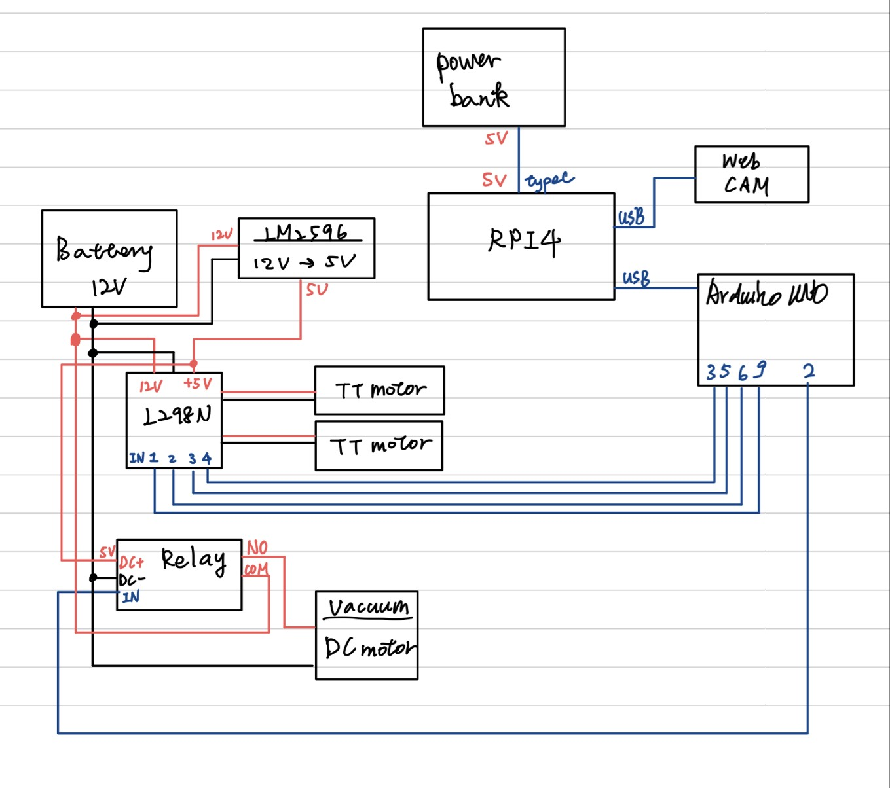
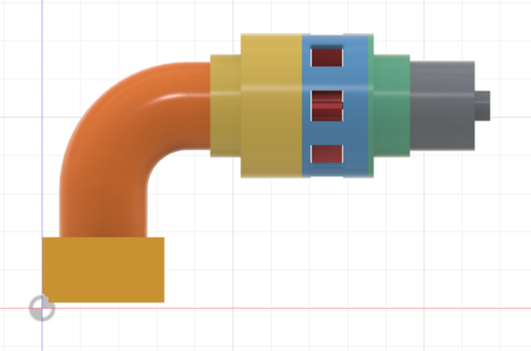
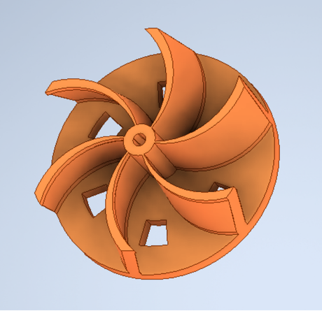

# 智慧吸塵車（Smart Vacuum Car）

國立臺灣大學 生物機電工程學系　機電整合（四）期末專題

一台可以**透過網頁遠端遙控**的吸塵小車：車上的 Webcam 即時串流畫面到瀏覽器，使用者用鍵盤操控行進方向與吸塵馬達。

<!-- 組員名單：經全體同意後再填入 -->

---

## 目錄

- [系統架構](#系統架構)
- [資料夾結構](#資料夾結構)
- [硬體](#硬體)
- [軟體安裝與執行](#軟體安裝與執行)
- [操作方式](#操作方式)
- [通訊協定](#通訊協定)
- [安全設計](#安全設計)
- [吸塵模組設計與迭代](#吸塵模組設計與迭代)
- [常見問題](#常見問題)

---

## 系統架構

```
 筆電瀏覽器 ──Wi-Fi（手機熱點）──▶ Raspberry Pi 4 ──USB 序列埠──▶ Arduino Uno ──▶ L298N ──▶ 兩顆 TT 馬達
     ▲                              │                                     └──▶ 繼電器 ──▶ 吸塵馬達
     └────── MJPEG 影像串流 ◀──── Webcam
```

| 元件 | 角色 |
|---|---|
| 筆電瀏覽器 | 顯示即時影像、送出鍵盤控制指令 |
| Raspberry Pi 4 | 影像串流伺服器（mjpg-streamer, port 8080）＋控制網頁伺服器（`app.py`, port 5000） |
| Arduino Uno | 接收指令，輸出 PWM 驅動馬達、控制繼電器 |
| L298N | 雙 H 橋馬達驅動，差速轉向 |
| 繼電器 | 開關吸塵馬達 |

---

## 資料夾結構

```
G09-smart-vacuum-car/
├── software/
│   ├── raspberry_pi/
│   │   ├── app.py              # 控制伺服器（Python，免安裝框架）
│   │   └── index.html          # 控制網頁（影像＋按鍵）
│   └── arduino/
│       └── car_controller/
│           └── car_controller.ino   # 馬達與吸塵控制
├── hardware/
│   └── wiring_diagram.jpg      # 電路接線圖
├── mechanical/
│   ├── upper_plate_lasercut.dxf    # 上層板雷切檔
│   ├── lower_plate_lasercut.dxf    # 下層板雷切檔
│   ├── plate_layout.png
│   └── chassis_3d_front.png
├── vacuum/
│   ├── images/                 # 吸嘴三次迭代、葉輪
│   └── videos/                 # 吸塵模擬影片
└── docs/
    └── startup_guide.pdf       # 開工／收工操作指南
```

---

## 硬體

### 主要零件

- Raspberry Pi 4（Raspberry Pi OS 64-bit）＋ 行動電源（5V 3A）
- Logitech C310 Webcam
- Arduino Uno
- L298N 馬達驅動模組
- TT 減速馬達 ×2、萬向輪 ×1
- 繼電器模組 ＋ 直流吸塵馬達
- 12V 電池、LM2596 降壓模組（12V → 5V）
- 3 mm 椴木板（雷切車板）

### 電源

| 電源 | 供電對象 |
|---|---|
| 行動電源 5V | Raspberry Pi 4（再由 USB 供電給 Webcam、Arduino） |
| 12V 電池 | L298N（馬達）、吸塵馬達（經繼電器） |
| LM2596 5V | 繼電器模組 |

### Arduino 腳位

| Arduino | 接到 |
|---|---|
| D9 / D6 | L298N IN1 / IN2（馬達 A） |
| D5 / D3 | L298N IN3 / IN4（馬達 B） |
| D2 | 繼電器 IN |
| GND | L298N GND（**必須共地**） |

> ⚠ D3、D5、D6、D9 都是 PWM 腳，程式直接在 IN 腳做 PWM 調速，所以 **L298N 上 ENA、ENB 的跳帽要插著**。



---

## 軟體安裝與執行

### 1. 燒錄 Raspberry Pi

用 Raspberry Pi Imager 燒錄 **Raspberry Pi OS (64-bit)**，自訂設定：主機名稱 `robot`、使用者 `pi`、Wi-Fi（手機熱點）、**開啟 SSH**。

### 2. 安裝套件（在 Pi 上執行一次）

```bash
sudo apt update
sudo apt install -y git cmake libjpeg-dev gcc g++ python3-serial
git clone https://github.com/jacksonliam/mjpg-streamer.git
cd mjpg-streamer/mjpg-streamer-experimental
make && sudo make install
```

### 3. 把程式傳進 Pi（在筆電執行）

```bash
scp -r software/raspberry_pi pi@robot.local:~/robot_control
```

### 4. 燒錄 Arduino

用 Arduino IDE 開啟 `software/arduino/car_controller/car_controller.ino`，開發板選 **Arduino Uno**，上傳後用 USB 線接到 Pi。

### 5. 啟動（開兩個 SSH 視窗）

```bash
# 視窗 A：影像串流
mjpg_streamer -i "input_uvc.so -d /dev/video0 -r 640x480 -f 15" -o "output_http.so -p 8080 -w /usr/local/share/mjpg-streamer/www"

# 視窗 B：控制伺服器
cd ~/robot_control && python3 app.py
```

瀏覽器打開 **`http://robot.local:5000/`** 即可。沒接 Arduino 時 `app.py` 會進入模擬模式，終端機會印出原本要送出的指令。

完整步驟（含收工、除錯）見 [docs/startup_guide.pdf](docs/startup_guide.pdf)。

---

## 操作方式

| 按鍵 | 功能 |
|---|---|
| W / S | 前進 / 後退 |
| A / D | 原地左轉 / 右轉 |
| 放開按鍵 / 空白鍵 | 停車 |
| V | 吸塵馬達 開 / 關 |
| 車速滑桿 | PWM 0–255（建議 ≤ 180） |

---

## 通訊協定

**網頁 → Pi**：`POST /api/command`，內容 `{"cmd": "F", "speed": 180}`
**Pi → Arduino**：USB 序列埠 115200 baud，每行一個指令

| 指令 | 意義 |
|---|---|
| `F180` / `B180` | 前進 / 後退，速度 180 |
| `L180` / `R180` | 原地左轉 / 右轉 |
| `S` | 停止 |
| `V` / `v` | 吸塵開 / 關 |

`GET /api/status` 可查詢最後指令、車速、吸塵狀態、Arduino 是否連線。

---

## 安全設計

1. **放開即停**：放開按鍵或網頁失去焦點，立即送出 `S`。
2. **三層斷線保護**：移動中網頁每 0.15 秒重送指令；Pi 端超過 0.5 秒沒收到就停車；Arduino 端超過 0.4 秒沒收到也會自行停車。網頁關掉、Wi-Fi 斷線或 Pi 當機，車子都會停。
3. **軟加減速**：速度每 10 ms 最多變化 9，從全速到停約 0.3 秒，避免吸塵模組在車頭時急煞前翻、起步打滑。
4. **自動重連**：Arduino 被拔掉再插回，`app.py` 會自動重新連線。
5. **結束保護**：按 Ctrl+C 結束 `app.py` 時，自動送出停車與關閉吸塵。

---

## 吸塵模組設計與迭代

吸塵模組由**吸嘴、葉輪（離心風扇）、外殼、馬達**組成。

| 版本 | 設計 |
|---|---|
| 吸嘴 v1 | 矩形吸口接 90° 圓形彎管，連到葉輪外殼與馬達座 |
| 吸嘴 v2 | 漸寬的扁平吸口，斜管連接，法蘭四孔鎖固在外殼上 |
| 吸嘴 v3 | 矩形吸口以漸縮直管連到圓柱外殼，內含葉輪與馬達，下方有固定座 |

<!-- 可以在這裡補上每一版的改進原因與測試結果 -->

| 吸嘴 v1 | 吸嘴 v2 | 吸嘴 v3 |
|---|---|---|
|  |  |  |

**葉輪**：6 片後彎式葉片的離心葉輪。



**吸塵模擬影片**

- [初版模擬](vacuum/videos/suction_simulation_v1.mp4)
- [最終版模擬](vacuum/videos/suction_simulation_final.mp4)

---

## 常見問題

| 狀況 | 解法 |
|---|---|
| Pi 連不上熱點 | 確認 Imager 裡的 Wi-Fi 名稱與密碼完全一致；手機熱點開「最大化相容性」、畫面停在熱點頁；Pi 拔電重開 |
| 串流出現 `init_VideoIn failed` | Pi 拔電 10 秒，先插 Webcam 再開機 |
| 網頁顯示 Arduino 未連接 | 檢查 USB 線，重新執行 `python3 app.py` |
| 網頁有反應但輪子不轉 | 檢查共地、ENA/ENB 跳帽、馬達電池 |
| 輪子方向不對 | 修改 `car_controller.ino` 開頭的 `INVERT_LEFT` / `INVERT_RIGHT` / `SWAP_LR` |
| Pi 不穩定 | `vcgencmd get_throttled` 不是 `0x0` 代表電源不足 |

---

## 參考

- [jacksonliam/mjpg-streamer](https://github.com/jacksonliam/mjpg-streamer)
